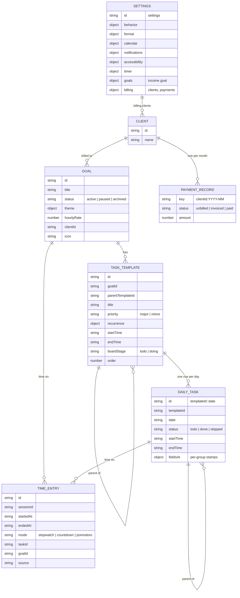
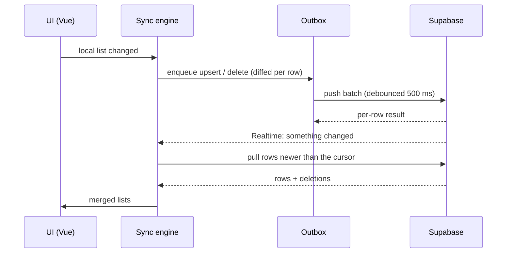

# Architecture

This document explains how DayForge is put together and why. Read it before a change that
touches more than one feature, the data model or sync. Folder and import rules in detail are in
[frontend/dayforge-app/README-structure.md](frontend/dayforge-app/README-structure.md).

## Contents

- [Principles](#principles)
- [Layers](#layers)
  - [Features](#features)
- [Data model](#data-model)
  - [Templates and days](#templates-and-days)
- [Local storage](#local-storage)
- [Sync](#sync)
  - [Server shape](#server-shape)
  - [The cycle](#the-cycle)
- [Cross-feature communication](#cross-feature-communication)
- [Build and loading](#build-and-loading)
- [Push reminders](#push-reminders)
- [Security and privacy](#security-and-privacy)
- [Testing](#testing)

## Principles

1. **Local first.** The browser holds the whole account. Every read and write is local and
   instant; the network only copies changes between devices. With no Supabase keys the app is
   complete on its own.
2. **Rules are plain functions.** Recurrence, merge, board, billing and tour rules have no Vue
   and no storage, so they run in plain node (`npm run verify:sync`) and in the Edge Function.
3. **Features are isolated.** A feature owns its UI and state and exposes a small public API.
   Shared code knows nothing about features. The boundaries are checked by ESLint and tests.
4. **History does not change.** A day's task is its own row, so editing a template later never
   rewrites what happened before.

## Layers

```
pages ──▶ features ──▶ shared, entities, sync, lib, i18n
```

| Layer                | Contents                                                                              |
| -------------------- | ------------------------------------------------------------------------------------- |
| `pages`              | `MainPage.vue` (the app shell) and `useMainPageState` (wiring)                        |
| `features/<name>`    | one product area: `components/`, `composables/`, `index.ts` (public API)              |
| `shared/ui`          | generic components: `AppIcon`, `ProjectIcon`, `DisclosureSection`, …                  |
| `shared/composables` | the goal space, timer, settings, theme, sync glue, billing rules, the user-action bus |
| `entities`           | domain types and constants                                                            |
| `sync`               | the sync engine: merge, outbox, tombstones, transport                                 |
| `lib`                | storage helpers, Supabase client, error reporting                                     |
| `i18n`               | translations                                                                          |

What is enforced (ESLint and `tests/unit/architecture.test.ts`):

- `pages` may import anything.
- A feature may import shared code, the base layers, and other features only through their
  `index.ts`. It may not import `pages`.
- `shared`, `entities`, `sync`, `lib` and `i18n` may not import features or pages.

The base layers are not strictly ordered among themselves. Three links exist today: an entity
type comes from `sync/merge` (`DailyFieldGroup`), `sync/fieldGroups` reads the list of synced
settings sections from `shared/composables/settingsRow`, and `lib/monitoring` reads the user
from `useAuth`. Keep such links to types and small constants.

`MainPage` is the composition root: it owns the goal space and passes data down as props.
Features use each other only through `features/<name>/index.ts`, and the feature graph has no
cycles (`analytics → settings → goals → board → tasks → timer`; `sidebar`, `hotkeys` and
`calendar` sit on top; `onboarding`, `profile`, `sync` and `timer` depend on no other feature).

### Features

| Feature      | What it owns                                                                              |
| ------------ | ----------------------------------------------------------------------------------------- |
| `goals`      | the project panel: header, stats, habit calendar, notes, budget chip                      |
| `tasks`      | task list and rows, composer, inline editor, move dialog, planned, archive, drag and drop |
| `board`      | the per-project Kanban board                                                              |
| `calendar`   | day / week / month views, time blocking, event details                                    |
| `timer`      | timer view and widget, time entries, away and long-run reminders                          |
| `analytics`  | time charts, habits, plan vs actual, earnings, income goal, billing and exports           |
| `settings`   | the settings panel and its sections, backups, project themes and rates                    |
| `sidebar`    | navigation, project list and reordering, mobile top bar                                   |
| `onboarding` | welcome flow, starter templates, the guided tour, coach tips                              |
| `hotkeys`    | quick add, the shortcuts sheet, shortcut tips                                             |
| `search`     | the global search palette                                                                 |
| `profile`    | account panel, avatar, account deletion                                                   |
| `sync`       | the sync status indicator                                                                 |

## Data model

All objects are plain JSON. Ids are generated on the client.



The single **active timer** is stored as one more row (`active-timer`), so a running timer
follows you between devices.

### Templates and days

A `TaskTemplate` is the task as you defined it. A `DailyTask` is that task on one date, with its
own status and times. Its id is `templateId::date`, so a day cannot be created twice, not even
by two devices at once.

| Kind      | Defined by         | Behaviour                                                    |
| --------- | ------------------ | ------------------------------------------------------------ |
| Open      | no date, no repeat | carries forward to today until it is done                    |
| Planned   | one date           | appears on that date                                         |
| Recurring | a `RecurrenceRule` | daily / weekly / monthly / yearly / custom, with an end date |

The rules live in `shared/composables/goalSpace/` (`recurrence.ts`, `dailyTasks.ts`, `today.ts`,
`overnight.ts`). `useGoalSpace` combines them: it loads the stored lists, makes sure today's
rows exist, carries open tasks forward after midnight and exposes the actions the UI calls.
Paused and archived projects stop feeding today's list. Progress and analytics are computed
from these rows; nothing derived is stored.

## Local storage

Everything is saved in `localStorage` under keys that start with `dayforge-`, so account
deletion can clear the app's data completely without a list that may go stale. Sign-out
removes the account's data and keeps device-only state such as the theme
(`sync/accountDeletion.ts`, checked by `tests/sync/compat/signout.ts`).

| Key (examples)                                                      | Contents                            |
| ------------------------------------------------------------------- | ----------------------------------- |
| `dayforge-goals`, `dayforge-task-templates`, `dayforge-daily-tasks` | the goal space                      |
| `dayforge-time-entries-v1`, `dayforge-timer-active-v1`              | timer history and the running timer |
| `dayforge-settings-v1`, `dayforge-theme-v1`                         | settings and theme                  |
| `dayforge-tombstones-v1`                                            | recent deletions (see sync)         |
| `dayforge-sync-outbox-v1`, `dayforge-sync-meta-v1`                  | pending writes and pull cursors     |
| `dayforge-tour-v1`, `dayforge-tips-v1`                              | onboarding progress                 |

Reads go through `lib/storage.ts`, which survives a browser that refuses storage and parses
defensively: stored data is always sanitised on read, because it may come from an older
version of the app or from another device. Snapshots taken before risky merges are kept in
IndexedDB (`sync/snapshots.ts`). Users can export and import a full JSON backup in settings.

## Sync

Sync copies local changes to Supabase and pulls changes from other devices. The engine
(`src/sync/`) is plain TypeScript; `shared/composables/useSync.ts` connects it to Vue, Supabase
and the browser.

### Server shape

One table per kind of row (`goals`, `task_templates`, `daily_tasks`, `time_entries`, `settings`,
`active_timer`), each with the same four columns:

| Column       | Meaning                                                              |
| ------------ | -------------------------------------------------------------------- |
| `id`         | the client id                                                        |
| `user_id`    | the owner; every Row Level Security policy uses it                   |
| `data`       | the row as the app holds it (`jsonb`), including its own `updatedAt` |
| `updated_at` | set by a database trigger; used only as the pull cursor              |

The app's shapes change often and the merge rules live on the client, so columns per field would
need a migration for every new setting. A `keep_newest_row` trigger refuses a write older than
what is stored or older than a recorded deletion. A `deletions` table records deletions,
because a missing row cannot tell "deleted" from "not sent yet".

### The cycle



- **Push.** The engine watches each synced list, diffs it per row and queues upserts and
  deletes in the outbox. The outbox keeps the order of edits, survives a reload, retries with
  backoff (1 s up to 5 min) when offline or on a transient error, and moves writes the server
  rejects to a dead-letter list that can be retried from the UI.
- **Pull.** Rows newer than the stored cursor (the server clock, with a 30 s overlap) are pulled,
  then merged into the local lists. A device that has pulled before asks `pull_changes()` for
  every table and the deletions in one request; the first pull, a delta longer than a page, or a
  project without the function goes table by table with keyset paging. Realtime notifications
  only trigger a pull; they carry no data the app trusts. While the channel is live, the timed
  pull runs every 5 min (15 min in a hidden tab); without it, every 30 s (2 min hidden).
- **Merge.** The newer `updatedAt` wins, but per **field group**, not per row: ticking a task
  off on the phone and moving it in the calendar on the laptop are both kept (`status`, `time`
  and `date` groups on a day; `details`, `look`, `money`, `board`, `order` on a project, and so
  on in `sync/fieldGroups.ts`).
- **Deletions.** A deletion becomes a tombstone that holds the deleted row, so undo is exact and
  another device cannot bring the row back. Tombstones are swept after 30 days.
- **First sign-in.** If both the device and the account already have data, a snapshot is saved
  first and the two are merged in full. Signing in to a different account on the same device
  clears the previous account's local data.

Sync rules are covered by `tests/sync`: an in-memory server, two simulated devices, and compat
checks for each rule.

## Cross-feature communication

| Need                                    | Mechanism                                                                    |
| --------------------------------------- | ---------------------------------------------------------------------------- |
| show data                               | props from `MainPage` down                                                   |
| react to a click in a child             | an event to the direct parent only                                           |
| change a task from anywhere             | `useTaskActions()`, provided once by `useMainPageState`, injected where used |
| app-wide state (settings, timer, today) | shared singletons, imported directly                                         |
| "the user did X" (for the tour)         | `reportUserAction()` in `shared/composables/userActions`                     |

The user-action bus keeps the timer, hotkeys and features free of the onboarding feature: they
report what happened, and the tour, which subscribes once when it loads, decides whether a
step is done. The tour is part of the first chunk, so it never misses an early action.

## Build and loading

- Vite with Rolldown. Supabase and Vue get their own long-cached vendor chunks.
- Screens other than the project list (calendar, timer, analytics, planned, archive, settings,
  dialogs) are loaded on demand with `defineAsyncComponent`.
- Feature `index.ts` files are marked side-effect-free by a small plugin in `vite.config.ts`,
  so importing one piece of a feature does not pull the rest into the first chunk.
- After a deploy, a tab running the old build reloads once when it requests a chunk that no
  longer exists (`main.ts`).
- `public/sw.js` caches the app shell for offline use and shows push reminders; it never
  intercepts Supabase, Google or auth requests.

## Push reminders

When "Notify me when the app is closed" is on, the browser registers a Web Push subscription
in `push_subscriptions`. Every five minutes `pg_cron` calls the `push-reminders` Edge Function,
which reads each subscriber's settings, timer, tasks and entries, decides what is due with the
same rules as the app (`supabase/functions/push-reminders/rules.ts`) and sends each reminder
once (`push_log`). Setup is in [supabase/README.md](supabase/README.md).

## Security and privacy

- **Isolation.** Every table has Row Level Security: a signed-in user can read and write only
  rows where `user_id = auth.uid()`. `push_log` is service-role only.
- **Account deletion** is a `security definer` function that only ever deletes the caller's own
  rows and auth user, then the app clears local storage.
- **Headers.** `public/_headers` sets a strict Content Security Policy (scripts only from the
  app's origin; network only to Supabase and Sentry), `frame-ancestors 'none'`, HSTS and more.
- **Error reports** (Sentry) are production-only and opt-in by DSN. They carry no request bodies,
  query strings, cookies or component props; the user is tagged only with a one-way hash of
  the user id. Sync errors pass through `lib/errorReporter.ts`, which forwards only an error's
  name and a short code, never a message that could echo row data.
- **Secrets.** The browser only ever has the Supabase anon key and the public VAPID key. The
  service role key, the private VAPID key and the cron secret live in Supabase secrets and Vault.

## Testing

| Suite                                  | Runs in       | Covers                                                                   |
| -------------------------------------- | ------------- | ------------------------------------------------------------------------ |
| `tests/unit/useGoalSpace`              | Vitest        | the goal space: creating, scheduling, completing, undo, reloads          |
| `tests/unit/architecture`              | Vitest        | layer rules on the full import graph, no feature cycles, public APIs     |
| `tests/unit/userActions`, `tourWiring` | Vitest        | the user-action bus and the tour reacting to real actions                |
| `tests/unit/featureIndexPlugin`        | Vitest (node) | the bundler plugin, with real builds                                     |
| `tests/unit/appSmoke`                  | Vitest        | mounts the app and opens every screen with no Vue warnings               |
| `tests/sync/verify`                    | node          | the sync engine end to end against an in-memory server                   |
| `tests/sync/compat/*`                  | node          | each rule that must agree across devices and versions, i18n completeness |
